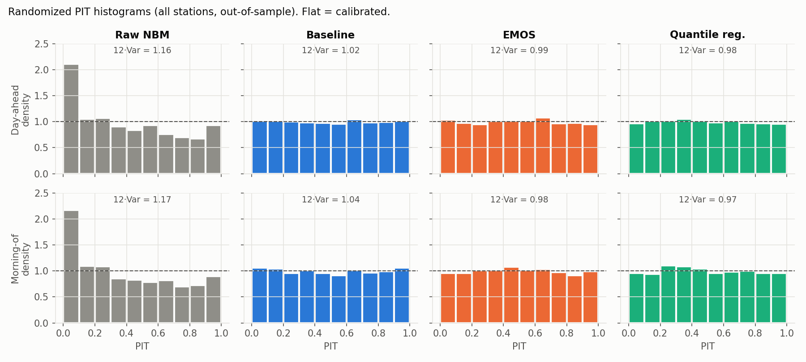
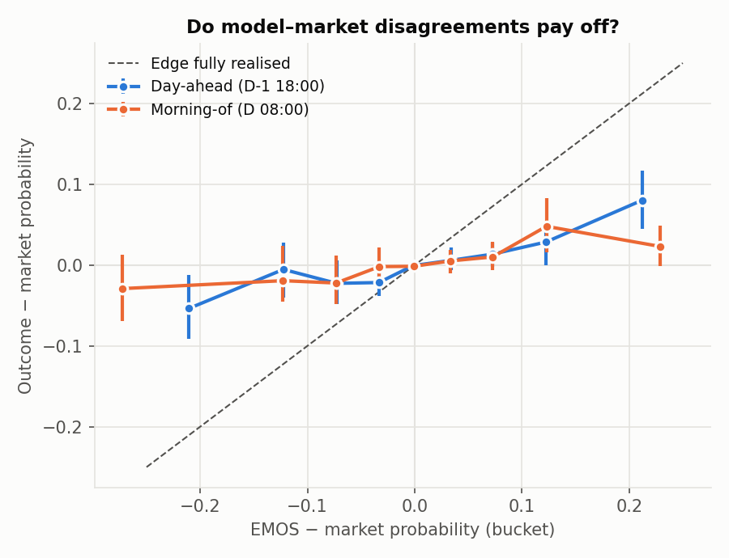

# tempmarkets

Probabilistic daily max-temperature forecasts vs. Polymarket prices.
Read-only analysis plus a paper-trading log. **No order placement code exists in this repo.**

## Setup
```bash
python3 -m venv .venv && .venv/bin/pip install -e ".[dev]"
.venv/bin/python -m pytest -q
.venv/bin/python scripts/00_probe_sources.py   # M0: verifies every data source
```

## Pipeline (run in order)
| Script | Does | First run |
|---|---|---|
| `01_fetch_obs.py` | IEM METAR/SPECI + NWS CLI + settled Polymarket events → `data/raw/` | ~5 min |
| `02_truth_table.py` | daily settlement max per era, validated vs. settled markets → `reports/m1_validation.md` | <1 min |
| `03_gap_analysis.py` | CLI vs. market max → `reports/m1_gaps.md` | seconds |
| `04_fetch_forecasts.py` | NBM (NBS) + GFS MOS archives → `data/raw/mos/` (paced for IEM's rate limit) | ~12 min |
| `05_build_features.py` | leak-free feature table + raw skill → `reports/m2_forecasts.md` | ~2 min |
| `06_fit_models.py` | monthly-refit out-of-sample distributions (raw NBM, baseline, EMOS, QR) → `data/processed/predictions.parquet`, `reports/m3_models.md` | ~8 min |
| `07_verify.py` | CRPS / log score / bucket Brier & log loss, PIT, reliability, bootstrap CIs → `reports/m4_verification.md`, `reports/figures/` | ~2 min |
| `08_fetch_prices.py` | hourly CLOB price history for every bucket of every settled event → `data/raw/prices/` | ~45 min |
| `09_market_compare.py` | model vs. market scores, edge calibration, hypothetical rule → `reports/m5_market.md` | ~2 min |

Downloads are cached. Re-runs only re-fetch the current year.

## Settlement rules change over time
Polymarket's rule text for these markets has three eras (confirmed for KMIA, KLGA, KORD, KDAL, KATL, KAUS):

| Era | Observation dates | Settles on |
|---|---|---|
| `wu` | through 2026-08-22 | Weather Underground Daily Observations max, whole °F (METAR+SPECI) |
| `nws_ts` | 2026-08-23 → 2026-10-22 | weather.gov/wrh/timeseries "Temp" max, whole °F |
| `metar` | 2026-10-23 → | Routine METARs only (no SPECI), T-group tenths °C (else body °C) → °F, half-up, local day |

`src/tempmarkets/truth.py` rebuilds each era's daily max from IEM METAR data. Models target the
`metar` rule, and market comparisons score each day with the rule in force on that day.

## Milestones
- **M0** source probe + station selection ✅
- **M1** ground truth + CLI gap analysis + validation against settled outcomes ✅ (`reports/m1_validation.md`, `reports/m1_gaps.md`)
- **M2** day-ahead NBM/MOS forecasts with issuance-time guards ✅ (`reports/m2_forecasts.md`)
  - Checkpoints: D-1 18:00 local (day-ahead) and D 08:00 local (morning-of). Each uses the latest
    run published by then, assuming NBM is out 90 min and GFS MOS 4 h after the run time.
  - NBM daily max/spread (`txn`/`xnd`) exist from 2020-09-30 (the NBM v4.0 upgrade). GFS MOS covers 2020→.
- **M3** baseline / EMOS / quantile regression → bucket probabilities ✅ (`reports/m3_models.md`)
  - EMOS and QR beat raw NBM by 10–18% CRPS out-of-sample (2022-01 → 2026-11) and remove its +0.3–0.8°F warm bias.
- **M4** verification (CRPS, RPS, Brier, log loss, PIT, reliability), time-based splits ✅ (`reports/m4_verification.md`)
  - Pooled day-ahead CRPS skill vs raw NBM: EMOS +12.6% [11.0, 14.1], QR +12.3% (95% block-bootstrap CIs); EMOS ≈ QR.
  - EMOS/QR PIT is flat (12·Var 0.92–1.05); raw NBM is too narrow and warm-biased.


- **M5** model vs. market calibration + forward paper-trading log ✅ (`reports/m5_market.md`)
  - **The market forecasts better than the model.** Log-loss skill vs. market, all stations:
    day-ahead −5.6% [−10.9, −0.5], morning-of −20.6% [−26.1, −13.4]. By 08:00 the market has
    overnight observations and newer guidance than the 06/07Z NBM run.
  - **The model still carries some information.** Its disagreements with the market point the right way,
    but only about a third of each edge is realised. A 50/50 log-blend roughly matches the market
    day-ahead (+1.3% [−1.2, +3.6]) and beats it at KMIA (+4.3% [+0.5, +7.4]).
  - **No evidence of a current edge.** A paper rule (buy the best-edge bucket when edge > 5¢ after an
    assumed 1¢ half-spread and fees) looks profitable through mid-2026, but loses money in every era
    since 2026-08-23 and is wiped out by a 2¢ half-spread. History prices aren't executable fills.

## Paper-trading log (read-only)
`scripts/paper_snapshot.py` reads live order books and the latest published NBM run, fits EMOS on
all history, and appends bucket snapshots and hypothetical $1 trades (edge > 5¢ vs. the live best ask,
after fees) to `paper_log/*.jsonl`. `scripts/paper_settle.py` scores them once markets resolve.
Nothing in this repo places orders. Run both once or twice a day:
```bash
.venv/bin/python scripts/paper_snapshot.py && .venv/bin/python scripts/paper_settle.py
```


