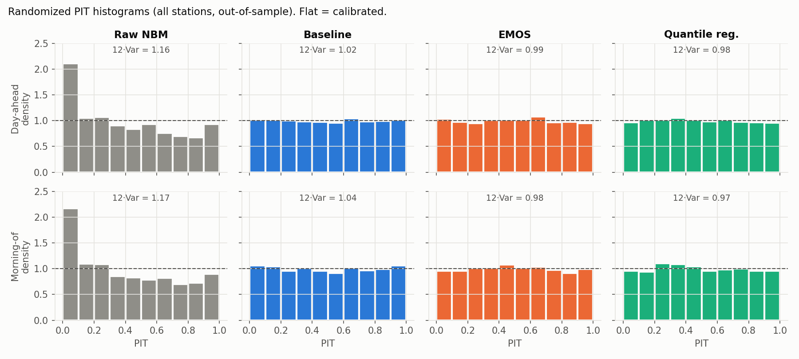
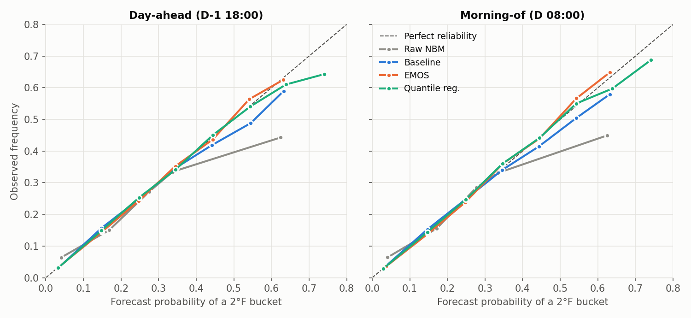
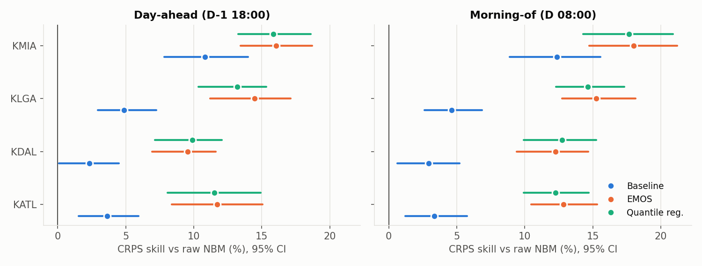

# M4: verification of out-of-sample predictive distributions

Test period 2022-01 → 2026-11 (monthly refit, expanding window, training cut off 2 days before each test month). Target = current METAR-rule settlement max.
Skill = 1 − score / reference score, with 95% CIs from a 30-day moving-block bootstrap on paired daily scores. Bucket metrics use today's 2°F market grid.

**PIT 12·Var**: 1.00 = calibrated spread; > 1 = too narrow (U-shaped PIT); < 1 = too wide (humped).

## Day-ahead (D-1 18:00)

| station | model | CRPS °F | CRPS skill vs raw NBM | vs baseline | log score | bucket Brier | bucket log loss | PIT 12·Var | ECE |
|---|---|---|---|---|---|---|---|---|---|
| KATL | Raw NBM | 1.424 | — | — | 2.485 | 0.768 | 1.797 | 1.14 | 0.022 |
| KATL | Baseline | 1.372 | +3.6% [+1.5%, +5.9%] | — | 2.446 | 0.745 | 1.726 | 1.04 | 0.007 |
| KATL | EMOS | 1.257 | +11.7% [+8.4%, +15.1%] | +8.4% [+4.6%, +12.0%] | 2.190 | 0.730 | 1.528 | 1.05 | 0.005 |
| KATL | Quantile reg. | 1.259 | +11.5% [+8.1%, +14.9%] | +8.2% [+4.3%, +12.0%] | 2.222 | 0.734 | 1.540 | 1.05 | 0.008 |
| KDAL | Raw NBM | 1.493 | — | — | 2.497 | 0.786 | 1.795 | 1.19 | 0.023 |
| KDAL | Baseline | 1.458 | +2.3% [+0.1%, +4.5%] | — | 2.520 | 0.770 | 1.773 | 1.00 | 0.007 |
| KDAL | EMOS | 1.350 | +9.5% [+6.9%, +11.6%] | +7.4% [+4.9%, +9.5%] | 2.262 | 0.748 | 1.591 | 0.98 | 0.006 |
| KDAL | Quantile reg. | 1.345 | +9.9% [+7.2%, +12.1%] | +7.7% [+5.4%, +9.8%] | 2.290 | 0.747 | 1.596 | 0.97 | 0.009 |
| KLGA | Raw NBM | 1.445 | — | — | 2.581 | 0.800 | 1.877 | 1.31 | 0.039 |
| KLGA | Baseline | 1.375 | +4.9% [+2.9%, +7.2%] | — | 2.410 | 0.764 | 1.708 | 0.99 | 0.006 |
| KLGA | EMOS | 1.236 | +14.5% [+11.2%, +17.1%] | +10.1% [+6.3%, +13.2%] | 2.200 | 0.730 | 1.532 | 0.99 | 0.006 |
| KLGA | Quantile reg. | 1.254 | +13.2% [+10.3%, +15.3%] | +8.7% [+5.3%, +11.1%] | 2.248 | 0.739 | 1.562 | 0.99 | 0.003 |
| KMIA | Raw NBM | 0.944 | — | — | 2.058 | 0.671 | 1.395 | 0.93 | 0.037 |
| KMIA | Baseline | 0.842 | +10.8% [+7.8%, +14.0%] | — | 1.948 | 0.627 | 1.266 | 1.03 | 0.010 |
| KMIA | EMOS | 0.792 | +16.1% [+13.5%, +18.7%] | +5.9% [+3.9%, +7.7%] | 1.773 | 0.603 | 1.144 | 0.94 | 0.014 |
| KMIA | Quantile reg. | 0.794 | +15.9% [+13.3%, +18.6%] | +5.6% [+3.8%, +7.4%] | 1.788 | 0.602 | 1.145 | 0.92 | 0.011 |

## Morning-of (D 08:00)

| station | model | CRPS °F | CRPS skill vs raw NBM | vs baseline | log score | bucket Brier | bucket log loss | PIT 12·Var | ECE |
|---|---|---|---|---|---|---|---|---|---|
| KATL | Raw NBM | 1.369 | — | — | 2.421 | 0.759 | 1.748 | 1.16 | 0.035 |
| KATL | Baseline | 1.324 | +3.3% [+1.2%, +5.8%] | — | 2.419 | 0.734 | 1.703 | 1.07 | 0.007 |
| KATL | EMOS | 1.193 | +12.8% [+10.5%, +15.3%] | +9.8% [+7.2%, +12.4%] | 2.138 | 0.703 | 1.487 | 1.04 | 0.008 |
| KATL | Quantile reg. | 1.201 | +12.3% [+9.9%, +14.7%] | +9.2% [+6.4%, +11.9%] | 2.156 | 0.707 | 1.485 | 1.03 | 0.008 |
| KDAL | Raw NBM | 1.437 | — | — | 2.510 | 0.776 | 1.802 | 1.22 | 0.025 |
| KDAL | Baseline | 1.395 | +2.9% [+0.6%, +5.2%] | — | 2.478 | 0.756 | 1.735 | 1.04 | 0.006 |
| KDAL | EMOS | 1.261 | +12.3% [+9.4%, +14.7%] | +9.6% [+7.1%, +12.1%] | 2.219 | 0.724 | 1.551 | 0.99 | 0.007 |
| KDAL | Quantile reg. | 1.254 | +12.7% [+9.9%, +15.3%] | +10.1% [+7.4%, +12.6%] | 2.226 | 0.723 | 1.536 | 0.97 | 0.005 |
| KLGA | Raw NBM | 1.389 | — | — | 2.538 | 0.782 | 1.843 | 1.29 | 0.035 |
| KLGA | Baseline | 1.325 | +4.6% [+2.6%, +6.9%] | — | 2.388 | 0.753 | 1.682 | 1.02 | 0.003 |
| KLGA | EMOS | 1.177 | +15.3% [+12.7%, +18.1%] | +11.2% [+8.5%, +14.0%] | 2.173 | 0.707 | 1.521 | 0.96 | 0.009 |
| KLGA | Quantile reg. | 1.185 | +14.6% [+12.3%, +17.3%] | +10.5% [+8.2%, +13.1%] | 2.177 | 0.718 | 1.504 | 0.96 | 0.004 |
| KMIA | Raw NBM | 0.905 | — | — | 1.999 | 0.667 | 1.336 | 0.92 | 0.041 |
| KMIA | Baseline | 0.793 | +12.4% [+8.9%, +15.5%] | — | 1.887 | 0.611 | 1.210 | 1.03 | 0.007 |
| KMIA | EMOS | 0.742 | +18.0% [+14.7%, +21.2%] | +6.4% [+4.6%, +8.1%] | 1.706 | 0.585 | 1.086 | 0.94 | 0.012 |
| KMIA | Quantile reg. | 0.746 | +17.7% [+14.3%, +20.9%] | +6.0% [+4.3%, +7.8%] | 1.721 | 0.587 | 1.090 | 0.93 | 0.011 |

## Pooled over stations

| checkpoint | comparison | CRPS skill | log-score diff (nats) |
|---|---|---|---|
| d1_1800 | EMOS vs Raw NBM | +12.6% [+11.0%, +14.1%] | -0.299 |
| d1_1800 | Quantile reg. vs Raw NBM | +12.3% [+10.7%, +13.7%] | -0.268 |
| d1_1800 | EMOS vs Baseline | +8.1% [+6.0%, +10.0%] | -0.225 |
| d1_1800 | Quantile reg. vs Baseline | +7.8% [+5.8%, +9.4%] | -0.194 |
| d1_1800 | Quantile reg. vs EMOS | -0.4% [-0.9%, +0.2%] | +0.031 |
| d0_0800 | EMOS vs Raw NBM | +14.2% [+12.6%, +16.0%] | -0.308 |
| d0_0800 | Quantile reg. vs Raw NBM | +14.0% [+12.3%, +15.7%] | -0.297 |
| d0_0800 | EMOS vs Baseline | +9.6% [+7.8%, +11.4%] | -0.235 |
| d0_0800 | Quantile reg. vs Baseline | +9.3% [+7.4%, +11.3%] | -0.223 |
| d0_0800 | Quantile reg. vs EMOS | -0.3% [-0.8%, +0.3%] | +0.011 |

## Day-ahead EMOS CRPS skill vs raw NBM, by season

| station | DJF | MAM | JJA | SON |
|---|---|---|---|---|
| KATL | +16.8% | +15.0% | +8.5% | +2.7% |
| KDAL | +13.1% | +8.8% | +8.0% | +6.8% |
| KLGA | +17.3% | +14.2% | +13.0% | +13.2% |
| KMIA | +13.3% | +19.5% | +18.5% | +12.6% |

## Figures

