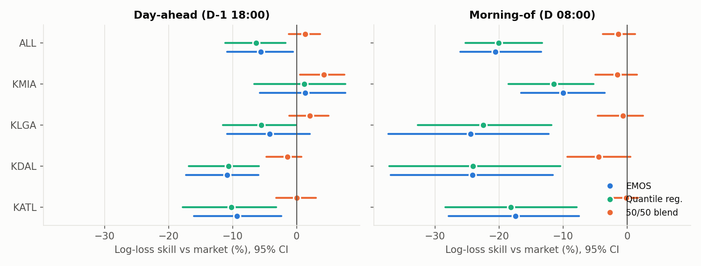
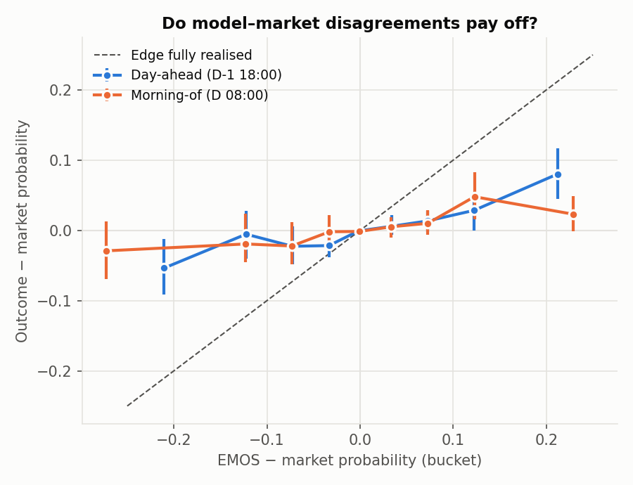
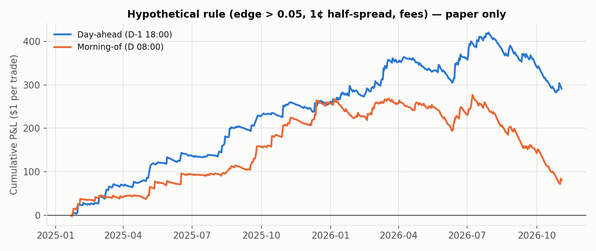

# M5: model vs. Polymarket on settled events

1560 settled events (2025-01-22 → 2026-11-03), scored at both checkpoints where an out-of-sample forecast and fresh (≤6 h old) prices for every bucket exist. Skipped event-checkpoints: {'no_pred': 56, 'no_price': 102, 'no_winner': 0}.

- **Market** = hourly CLOB price at the checkpoint, normalised to sum to 1 (median overround +2.8%). Not executable quotes.
- **Outcome** = the market's own settled winner, so each era is scored by the rule it used. The model targets the current routine-METAR rule; for pre-2026-08-23 events (which counted SPECI) this costs it a little on the ~3% of days where SPECI moves the max.
- **Blend** = 50/50 logarithmic pool of EMOS and market.
- Log loss floors probabilities at 0.001 (the CLOB tick) for every forecaster alike.

## Who forecasts better?

Log-loss skill vs. market = 1 − LL / LL(market), 95% CI from a 30-day block bootstrap. Positive = better than the market.

| checkpoint | station | events | market LL | EMOS LL | EMOS skill | QR skill | blend skill | market fav. wins | EMOS fav. wins |
|---|---|---|---|---|---|---|---|---|---|
| d1_1800 | KATL | 319 | 1.238 | 1.354 | -9.3% [-16.0%, -2.4%] | -10.2% [-17.8%, -3.2%] | +0.0% [-3.2%, +3.0%] | 50.8% | 43.3% |
| d1_1800 | KDAL | 320 | 1.167 | 1.294 | -10.8% [-17.3%, -6.0%] | -10.7% [-16.9%, -5.9%] | -1.4% [-4.8%, +0.7%] | 49.4% | 46.2% |
| d1_1800 | KLGA | 628 | 1.354 | 1.411 | -4.2% [-10.9%, +2.1%] | -5.5% [-11.5%, -0.0%] | +2.0% [-1.2%, +5.0%] | 44.6% | 42.0% |
| d1_1800 | KMIA | 274 | 1.159 | 1.143 | +1.3% [-5.8%, +7.6%] | +1.2% [-6.7%, +7.6%] | +4.3% [+0.5%, +7.4%] | 51.8% | 55.5% |
| d1_1800 | **ALL** | 1541 | 1.257 | 1.327 | -5.6% [-10.9%, -0.5%] | -6.4% [-11.1%, -1.7%] | +1.3% [-1.2%, +3.6%] | 48.2% | 45.6% |
| d0_0800 | KATL | 317 | 1.118 | 1.313 | -17.4% [-27.9%, -7.5%] | -18.2% [-28.4%, -7.9%] | -0.1% [-2.2%, +1.6%] | 49.8% | 47.9% |
| d0_0800 | KDAL | 318 | 1.014 | 1.259 | -24.2% [-36.9%, -11.6%] | -24.1% [-37.2%, -10.4%] | -4.5% [-9.3%, +0.5%] | 56.9% | 47.5% |
| d0_0800 | KLGA | 627 | 1.132 | 1.408 | -24.5% [-37.3%, -12.3%] | -22.5% [-32.7%, -11.8%] | -0.6% [-4.6%, +2.5%] | 55.3% | 42.6% |
| d0_0800 | KMIA | 267 | 0.993 | 1.093 | -10.0% [-16.6%, -3.5%] | -11.5% [-18.6%, -5.3%] | -1.6% [-5.0%, +1.5%] | 56.6% | 53.2% |
| d0_0800 | **ALL** | 1529 | 1.080 | 1.303 | -20.6% [-26.1%, -13.4%] | -20.1% [-25.3%, -13.3%] | -1.4% [-3.8%, +1.2%] | 54.7% | 46.6% |

## By settlement era (all stations)

| checkpoint | era | events | market LL | EMOS LL | blend LL |
|---|---|---|---|---|---|
| d0_0800 | metar | 48 | 0.766 | 1.143 | 0.863 |
| d0_0800 | nws_ts | 244 | 1.061 | 1.323 | 1.119 |
| d0_0800 | wu | 1237 | 1.096 | 1.305 | 1.100 |
| d1_1800 | metar | 48 | 1.013 | 1.209 | 1.032 |
| d1_1800 | nws_ts | 244 | 1.131 | 1.361 | 1.190 |
| d1_1800 | wu | 1249 | 1.290 | 1.325 | 1.258 |

## Edge calibration (EMOS − market, per bucket)

If the model's disagreements carry information, realised excess (outcome − market prob) should have the same sign as the edge and grow with it.

| checkpoint | edge bin | buckets | mean edge | realised excess | 95% CI |
|---|---|---|---|---|---|
| d0_0800 | (-1.0, -0.15] | 807 | -0.272 | -0.029 | [-0.069, +0.013] |
| d0_0800 | (-0.15, -0.1] | 448 | -0.123 | -0.019 | [-0.046, +0.024] |
| d0_0800 | (-0.1, -0.05] | 736 | -0.073 | -0.022 | [-0.049, +0.012] |
| d0_0800 | (-0.05, -0.02] | 716 | -0.033 | -0.002 | [-0.026, +0.021] |
| d0_0800 | (-0.02, 0.02] | 8204 | -0.001 | -0.001 | [-0.004, +0.001] |
| d0_0800 | (0.02, 0.05] | 1085 | +0.033 | +0.005 | [-0.010, +0.019] |
| d0_0800 | (0.05, 0.1] | 1041 | +0.073 | +0.010 | [-0.007, +0.028] |
| d0_0800 | (0.1, 0.15] | 595 | +0.123 | +0.048 | [+0.015, +0.083] |
| d0_0800 | (0.15, 1.0] | 751 | +0.229 | +0.023 | [-0.002, +0.049] |
| d1_1800 | (-1.0, -0.15] | 605 | -0.211 | -0.054 | [-0.091, -0.013] |
| d1_1800 | (-0.15, -0.1] | 589 | -0.122 | -0.005 | [-0.040, +0.028] |
| d1_1800 | (-0.1, -0.05] | 941 | -0.073 | -0.023 | [-0.048, +0.006] |
| d1_1800 | (-0.05, -0.02] | 1110 | -0.033 | -0.022 | [-0.038, -0.005] |
| d1_1800 | (-0.02, 0.02] | 7847 | -0.002 | -0.001 | [-0.003, +0.002] |
| d1_1800 | (0.02, 0.05] | 1134 | +0.034 | +0.006 | [-0.006, +0.022] |
| d1_1800 | (0.05, 0.1] | 1140 | +0.073 | +0.014 | [-0.002, +0.027] |
| d1_1800 | (0.1, 0.15] | 564 | +0.122 | +0.029 | [-0.000, +0.053] |
| d1_1800 | (0.15, 1.0] | 601 | +0.212 | +0.080 | [+0.045, +0.117] |

## Hypothetical rule: buy best-edge bucket when edge > threshold (PAPER ONLY)

$1 per trade at the quoted price + half-spread, minus the event's taker fee (`shares × rate × p × (1 − p)`; 0 before 2026-03-30 and 2026-10-20→10-30, 5% otherwise). Quoted history prices are not fills, and size at those prices was often small, so treat these as an upper bound.

| checkpoint | threshold | half-spread | trades | hit rate | avg price | avg model p | total P&L ($) | ROI per $ | 95% CI |
|---|---|---|---|---|---|---|---|---|---|
| d0_0800 | 0.03 | 0.01 | 1247 | 18.8% | 0.160 | 0.300 | +108.1 | +8.7% | [-14.9%, +28.3%] |
| d0_0800 | 0.05 | 0.00 | 1181 | 18.3% | 0.157 | 0.302 | +228.5 | +19.4% | [-9.7%, +43.7%] |
| d0_0800 | 0.05 | 0.01 | 1099 | 18.7% | 0.156 | 0.307 | +81.2 | +7.4% | [-19.1%, +30.6%] |
| d0_0800 | 0.05 | 0.02 | 1018 | 18.9% | 0.156 | 0.315 | -10.4 | -1.0% | [-25.8%, +20.7%] |
| d0_0800 | 0.10 | 0.01 | 718 | 19.4% | 0.157 | 0.343 | +132.4 | +18.4% | [-18.1%, +52.1%] |
| d1_1800 | 0.03 | 0.01 | 1306 | 21.0% | 0.172 | 0.306 | +268.3 | +20.5% | [-1.7%, +41.0%] |
| d1_1800 | 0.05 | 0.00 | 1230 | 20.6% | 0.170 | 0.310 | +440.0 | +35.8% | [+7.2%, +62.0%] |
| d1_1800 | 0.05 | 0.01 | 1134 | 21.3% | 0.169 | 0.316 | +291.3 | +25.7% | [+0.9%, +49.4%] |
| d1_1800 | 0.05 | 0.02 | 1044 | 21.1% | 0.167 | 0.321 | +131.2 | +12.6% | [-10.4%, +34.8%] |
| d1_1800 | 0.10 | 0.01 | 700 | 22.7% | 0.170 | 0.354 | +219.0 | +31.3% | [-1.5%, +66.5%] |

By era (threshold 0.05, half-spread 0.01):

| checkpoint | era | trades | hit rate | ROI per $ | fees paid ($) |
|---|---|---|---|---|---|
| d0_0800 | metar | 41 | 7.3% | -48.3% | 0.59 |
| d0_0800 | nws_ts | 200 | 10.0% | -44.7% | 8.29 |
| d0_0800 | wu | 858 | 21.2% | +22.2% | 15.92 |
| d1_1800 | metar | 44 | 13.6% | -9.9% | 0.72 |
| d1_1800 | nws_ts | 197 | 9.6% | -37.3% | 8.08 |
| d1_1800 | wu | 893 | 24.3% | +41.3% | 15.55 |

## Figures

